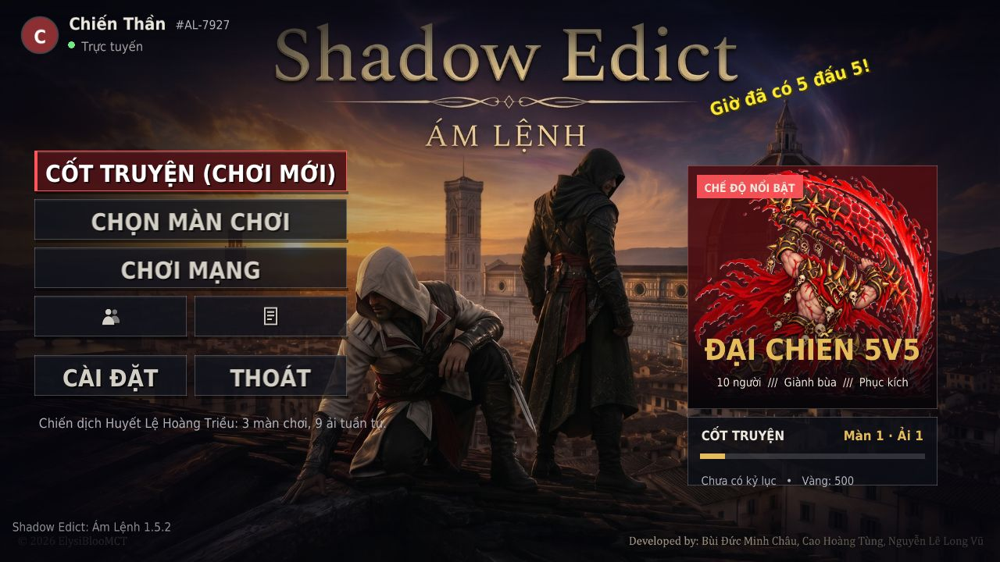
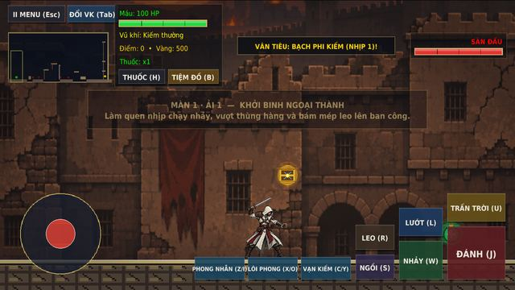
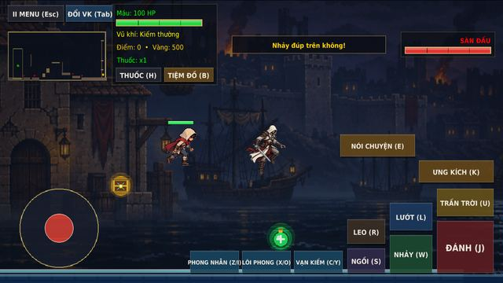
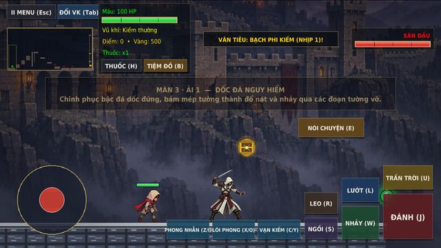
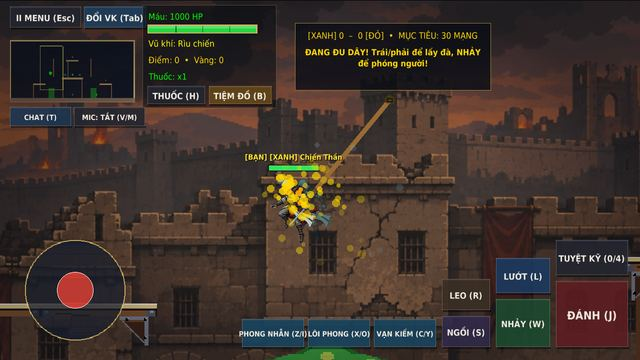
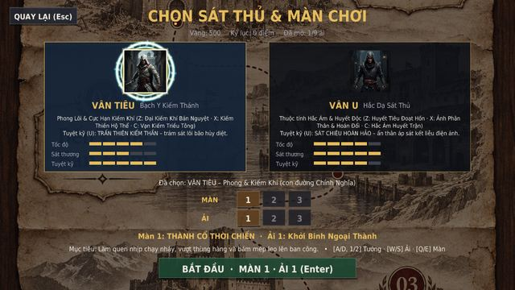
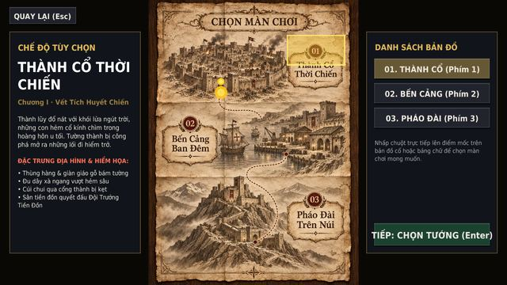

# Shadow Edict: Ám Lệnh

Game hành động platformer 2D viết bằng [libGDX](https://libgdx.com/) 1.14 (Java 11) + Box2D, chạy trên Desktop (LWJGL3) và Android.
Có kết nối Socket.IO tới server của nhóm cho chế độ online và hệ thống bạn bè.

🌐 **Website:** https://shadow.elysibloomct.qzz.io · 📥 **Tải game:** [Releases](https://github.com/ElysiBlooMCT/Shadow_Edict_Game/releases/latest)

## Chế độ chơi

| Chế độ | Mô tả |
|--------|-------|
| **Cốt truyện** | 3 màn Thành Cổ, Bến Cảng, Pháo Đài x 3 ải; bám mép, bám tường, đu dây, sàn sập, checkpoint, trùm cuối màn. Tiến độ được lưu để chơi tiếp. |
| **Đại chiến 5v5** | Phòng trực tuyến tới 10 người, 2 phe; bùa tranh chấp, bụi rậm phục kích, tháp tiền đồn. Đủ 30 mạng thì thắng. Có chế độ luyện tập một mình. |
| **Đấu trường 1v1** | Tạo/vào phòng bằng mã, mời bạn bè, ngọc tuyệt kỹ trên sàn đấu. |
| **Hợp tác 2 người** | Cùng vượt ải trên một bản đồ chung, hồi sinh đồng đội. |

Vũ khí: kiếm, cung, súng, rìu, song đao (Tab đổi vũ khí). Chat chữ và đàm thoại micro khi chơi trực tuyến.

## Hình ảnh

| | |
|---|---|
|  |  |
|  |  |
|  |  |

Thêm ảnh tại [trang Hình ảnh](https://shadow.elysibloomct.qzz.io/gallery/).

## Điều khiển (desktop)

`A/D` di chuyển · `W/Space` nhảy (nhảy đúp, bật tường) · `J` / chuột trái đánh (giữ để combo) ·
`L` / chuột phải / `Shift` lướt · `U` tuyệt kỹ · `K` ứng kích từ trên cao · `F/Q` ám sát sau lưng ·
`S` ngồi / đỡ đòn (parry) · `W` (giữ) leo thang/tường · `E` bắn pháo / cứu đồng đội ·
`B` tiệm đồ · `H` uống thuốc · `P/Esc` tạm dừng. Trên Android dùng joystick ảo và các nút trên màn hình.

## Cấu trúc mã nguồn (`core/src/main/java/io/qzz/elysibloomct/ctv/se`)

- `Main` – vòng đời game, chuyển màn hình an toàn (giải phóng màn cũ ở frame sau).
- `LoadingScreen`, `MainMenuScreen`, `CharacterSelectScreen`, `LobbyScreen` (PVP), `CoopLobbyScreen`, `Arena5v5LobbyScreen` – các màn hình.
- `GameScreen` – toàn bộ gameplay (vật lý, AI quái, 5v5, HUD, vẽ).
- `Fighter5v5`, `GroundMob`, `AncientTitan`, `OutpostTurret`, `PowerUpRune`, `SwingRope`, `JumpPad`, ... – thực thể.
- `NetworkManager` (Socket.IO), `PlayerProfile` (hồ sơ & cài đặt lưu cục bộ), `SoundManager`.
- `GameAssets` (bộ đệm texture), `UiKit` (giao diện dùng chung), `SettingsDialog`, `FriendsDialog`, `MatchInviteDialog`.

Lịch sử thay đổi: xem [CHANGELOG.md](CHANGELOG.md).

## Build & chạy

- Desktop: `gradlew lwjgl3:run` – đóng gói: `gradlew lwjgl3:jar` (file ở `lwjgl3/build/libs`).
- Android: mở bằng Android Studio hoặc `gradlew android:assembleDebug` (cần Android SDK, khai báo trong `local.properties`).
- Server Socket.IO: cấu hình địa chỉ tại `NetworkManager.SERVER_URL`.
- Website: thư mục `docs/` (GitHub Pages, xem `docs/AGENTS.md`).

Project được tạo từ [gdx-liftoff](https://github.com/libgdx/gdx-liftoff). Các tham số Gradle hữu ích:
`--offline`, `--refresh-dependencies`, `clean`, `android:lint`.

## Tải game

Bản mới nhất cho Android (7.0+), Windows, macOS, Linux: xem mục [Releases](https://github.com/ElysiBlooMCT/Shadow_Edict_Game/releases/latest) hoặc [website](https://shadow.elysibloomct.qzz.io/download/). Chưa có bản iOS.

## Bản quyền

© 2026 ElysiBlooMCT. All rights reserved.
Mã nguồn được công khai để tham khảo và học tập; không được sao chép, phân phối lại hay sử dụng mã nguồn, hình ảnh, âm thanh cho mục đích khác khi chưa có sự đồng ý của tác giả.
Dự án học tập, phi thương mại.

> Website và một phần mã nguồn game được thực hiện với sự hỗ trợ của AI (Claude).
